# AI Text Watermark & Provenance Lab (Python) — `wmlab`

A research-style **AI text watermarking** lab for MTech / PhD students and anyone studying how
"made with AI" labels actually work. It implements, tests and stress-tests:

1. **Text watermarks** — the green/red-list watermark of Kirchenbauer et al. (KGW) and a
   distortion-free **Gumbel / exponential-minimum** watermark (the family SynthID-Text builds on),
   with **z-score / p-value detection** that needs only the key, never the model.
2. **Robustness and false-positive experiments** — word substitution, deletion, insertion, swaps,
   paraphrasing, truncation, mixing into human text, zero-width and homoglyph tricks, false
   positives on human text across keys, and the repeated-text trap.
3. **Content provenance** — **C2PA-style signed manifests** for text and images: SHA-256 hard
   binding, perceptual (dHash) soft binding, **Ed25519 signatures**, a trust list and edit history,
   with a `verify` CLI.

Everything runs on a laptop CPU in seconds using a small trigram language model trained on
public-domain novels, so results are reproducible without a GPU or API key. An optional
Hugging Face backend repeats the core experiment on a real transformer (tested with
Qwen2.5-0.5B-Instruct and SmolLM2 on CPU).

📖 Full tutorial and research guide: **https://getprojects.org/ai-text-watermarking-python/**

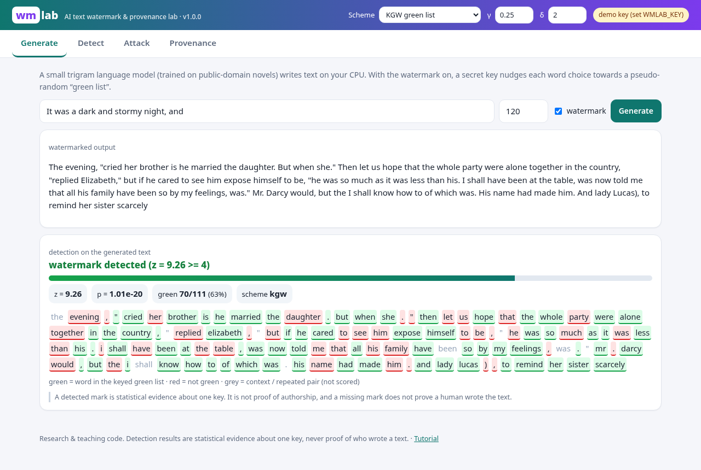

> **Defensive research code.** A detected watermark is statistical evidence about *one key*. It is
> not proof that a person used AI, and a missing watermark does not prove a human wrote the text.
> Never use a detector score alone to accuse a student or writer.

## Features

- **Two watermark schemes**: KGW soft watermark (`gamma`, `delta`, context width `h`) and Gumbel
  sampling (unbiased for a fixed key). Keyed BLAKE2b + SplitMix64 PRF, vectorised with numpy.
- **Detector** with z-score, p-value, verdict, minimum length, per-token green/red flags,
  **(context, token) de-duplication** and **Unicode normalisation** (NFKC, zero-width removal,
  Cyrillic/Greek homoglyph mapping) before scoring.
- **CPU language model**: interpolated trigram LM (~11k-word vocabulary) with temperature and
  top-k, so a full experiment run takes about a minute.
- **Attack library**: `substitute`, `delete`, `insert`, `swap`, `paraphrase` (rule-based),
  `truncate`, `mix` into human text, `zero_width`, `homoglyph`.
- **Experiment runner** → CSV files, matplotlib plots and a `summary.md`:
  E1 length, E2 robustness, E3 false positives, E4 quality (perplexity), E5 gamma / context width,
  E6 image provenance bindings.
- **Provenance**: `keygen` (Ed25519, private key mode 600), `sign` (sidecar JSON, embedded iTXt for
  PNG), `verify` (signature, hard binding, soft binding, trust list, parent ingredient).
  IPTC `digitalSourceType` values (`trainedAlgorithmicMedia`, ...) like real Content Credentials.
- **Flask UI** (Generate / Detect / Attack / Provenance) on 127.0.0.1 only, Host-header check,
  custom-header CSRF guard, strict CSP with no inline scripts or styles. The key never leaves the server.
- **Optional HF backend**: `LogitsProcessor` for KGW and Gumbel on any causal LM + LLM paraphrase attack.
- **229 pytest tests**, all offline.

## Quick start

```bash
git clone https://github.com/GetProjectsIdea/AI-Text-Watermark-Provenance-Lab-Python.git
cd AI-Text-Watermark-Provenance-Lab-Python
python -m venv .venv && source .venv/bin/activate      # Windows: .venv\Scripts\activate
pip install -r requirements-dev.txt

python -m wmlab demo                          # 10-second tour
python -m wmlab web                           # http://127.0.0.1:5088
python -m wmlab experiment all --out results  # CSV + plots + summary.md (~1 minute)
python -m pytest -q                           # 229 passed
```

Use your own secret key for anything beyond a demo (the built-in demo key is public):

```bash
export WMLAB_KEY="$(python -c 'import secrets; print(secrets.token_hex(16))')"
```

## Command line

```bash
# generate watermarked text with the CPU trigram LM, then detect it
python -m wmlab generate --prompt "It was a dark and stormy night" --tokens 200 --out wm.txt
python -m wmlab detect wm.txt --tokens            # coloured green/red tokens, z, p-value
python -m wmlab detect wm.txt --json
python -m wmlab generate --scheme gumbel --out g.txt && python -m wmlab detect g.txt --scheme gumbel

# attack it and measure again
python -m wmlab attack substitute wm.txt --rate 0.3 --out att.txt && python -m wmlab detect att.txt
python -m wmlab attack zero_width wm.txt --rate 0.5 | python -m wmlab detect -          # normalised away
python -m wmlab attack zero_width wm.txt --rate 0.5 | python -m wmlab detect - --raw    # evades raw detector

# provenance
python -m wmlab keygen --trust trusted/
python -m wmlab sign essay.txt --generator "my model" --watermark-scheme kgw
python -m wmlab verify essay.txt --trust trusted/
python -m wmlab sign poster.png                   # sidecar + manifest embedded in the PNG
python -m wmlab verify copy.jpg --manifest poster.png.manifest.json
python -m wmlab sign v2.txt --parent v1.txt.manifest.json && python -m wmlab verify v2.txt --parent v1.txt.manifest.json
```

Exit codes: `detect` returns 0 when a watermark is detected and 1 otherwise; `verify` returns 0
for a valid manifest and 2 otherwise, so both are scriptable.

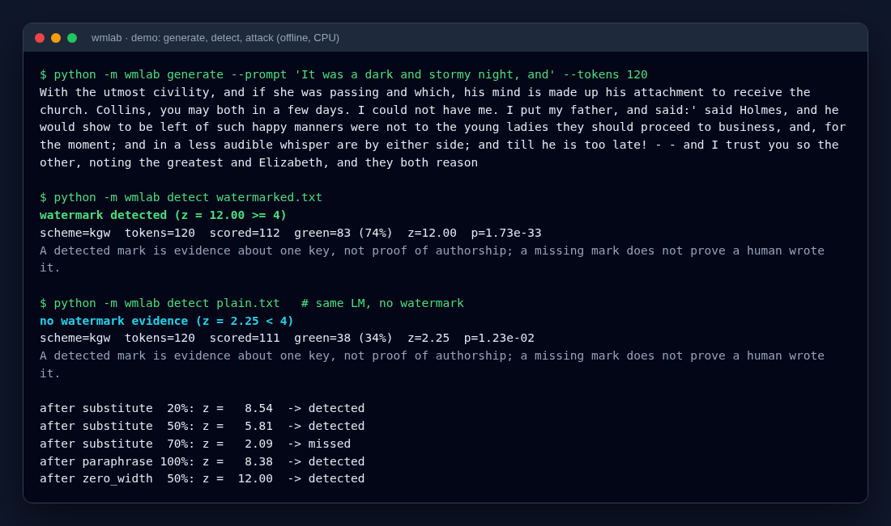

## How detection works

For every token after the first `h`, the detector hashes the key with the previous `h` token ids,
derives a pseudo-random number `u` for the current token and calls it **green** if `u < gamma`.
Without the watermark each token is green with probability `gamma`, so for `T` scored tokens
with `G` green ones

```
z = (G - gamma*T) / sqrt(T * gamma * (1 - gamma))
```

is approximately standard normal. The default threshold `z >= 4` means a one-sided false-positive
rate of about 3 in 100,000 *per test* (if tokens are independent, which is why repeated
(context, token) pairs are scored only once). For the Gumbel scheme the score is
`S = sum(-ln(1 - u_t))`, which is Gamma(T, 1) under the null; the p-value is converted to a
z-equivalent so both schemes share one threshold.

## Results (bundled run, `docs/results/`)

Toy trigram LM, 100 samples per cell, `gamma = 0.25`, threshold `z >= 4`. Full tables:
[`docs/results/summary.md`](docs/results/summary.md).

| finding | number |
|---|---|
| KGW delta=2 detection at 32 / 64 tokens | 89% / 100% |
| KGW delta=1 detection at 200 tokens | 96% |
| Human paragraphs flagged at z >= 4 (5 keys, 2 corpora) | 0 |
| KGW delta=2 mean z after 30% / 50% / 70% word substitution | 6.95 / 3.92 / 1.84 |
| Watermarked span = 10% of a human document (KGW / Gumbel detected) | 18% / 100% |
| Same human paragraph repeated 10x, no de-duplication: flagged at z >= 4 | 9% (theory: 0.003%) |
| ... with de-duplication | 0% |
| Median perplexity: none / KGW d=2 / KGW d=8 / Gumbel | 16.9 / 23.7 / 53.7 / 17.6 |
| JPEG q70 copy: hard binding valid / soft binding match | 0% / 100% |

**Real transformer check** (`examples/hf_experiment.py`, Qwen2.5-0.5B-Instruct on CPU, KGW
delta=2, 160 new tokens, 12 prompts): watermarked 12/12 detected (mean z 8.72); unwatermarked
0/12 (mean z 0.46); **after an LLM paraphrase by the same model without the watermark only 2/12**
(mean z 1.75); first 60 tokens only 6/12. See [`docs/results/hf_qwen2.5-0.5b-instruct.md`](docs/results/hf_qwen2.5-0.5b-instruct.md).

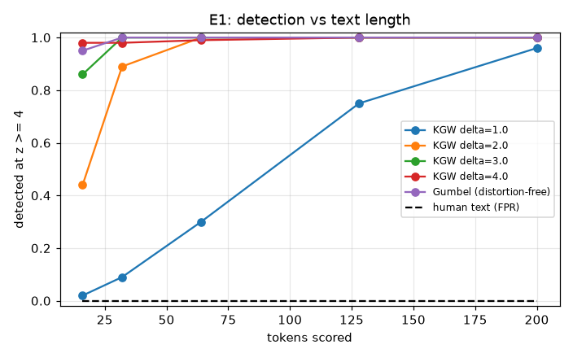
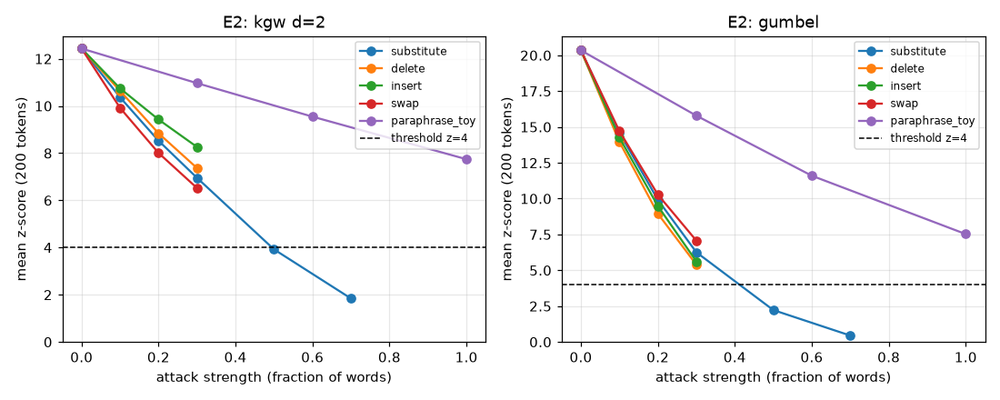
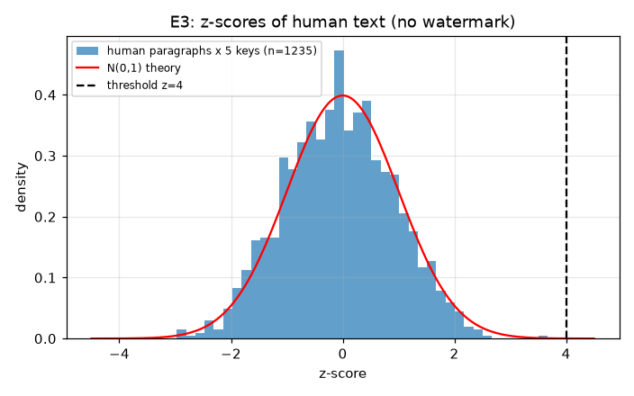
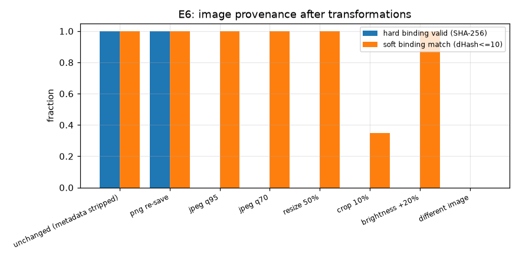

## Web UI

`python -m wmlab web` → http://127.0.0.1:5088

| Detect (human text, not flagged) | Attack (30% substitution) |
|---|---|
| 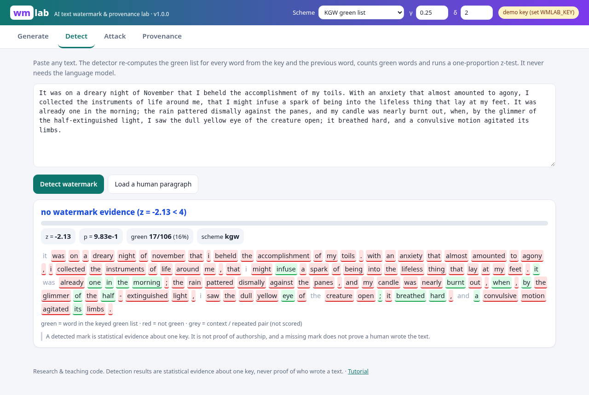 | 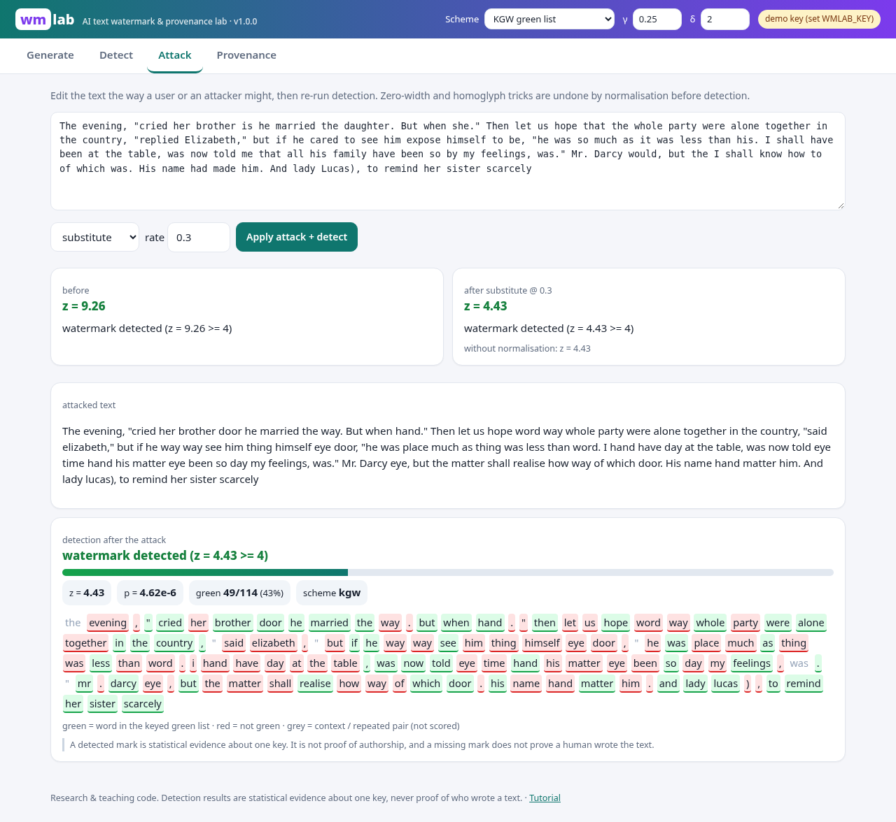 |

| Provenance: valid | Provenance: one word changed |
|---|---|
| 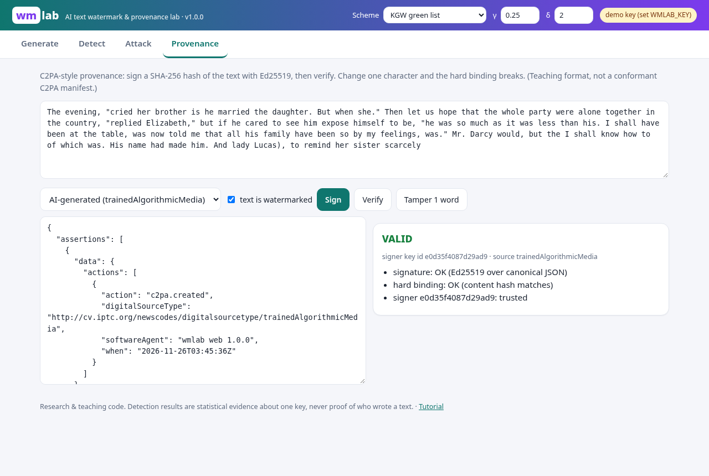 | 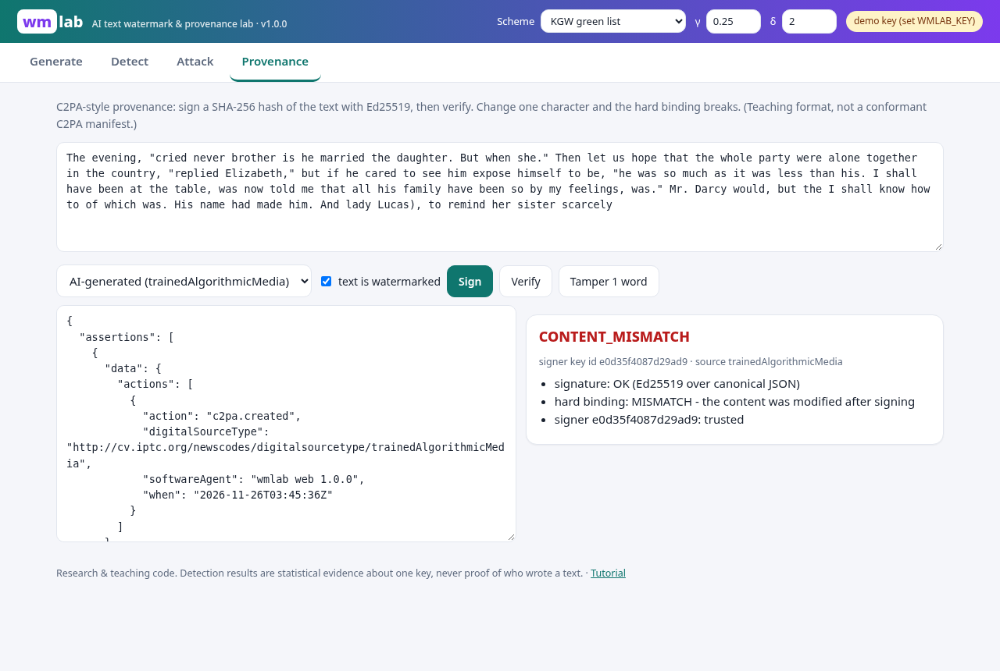 |

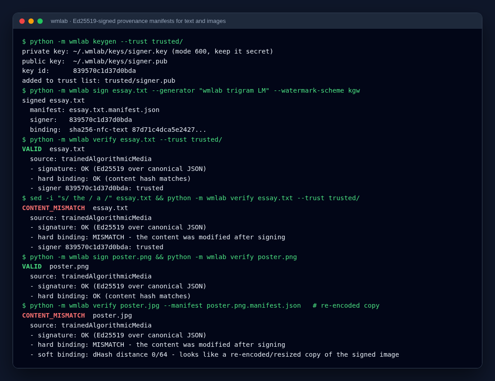

## Optional: real transformer backend

```bash
pip install torch transformers          # CPU wheels are fine for 0.5B models
python examples/hf_experiment.py --model Qwen/Qwen2.5-0.5B-Instruct --n 12 --out results
```

```python
from wmlab.backends.hf import HFWatermarker
from wmlab.watermark import WatermarkConfig

wm = HFWatermarker("HuggingFaceTB/SmolLM2-135M-Instruct", WatermarkConfig(key="my-key", delta=2.0))
out = wm.generate("Write a short paragraph about the monsoon in India.", 150)
print(wm.detect(out["text"]).verdict)
```

The HF backend watermarks the model's own tokenizer ids, so its texts must be checked with
`HFWatermarker.detect`, not with `wmlab detect` (word tokenizer).

## Project layout

```
wmlab/
├── tokenize.py      # word tokenizer, Unicode normalisation, stable 64-bit token ids
├── hashing.py       # keyed BLAKE2b context seed + SplitMix64 uniforms (numpy)
├── watermark.py     # KGW bias, Gumbel choice, z-score / p-value detection
├── lm.py            # CPU trigram LM, generation, perplexity
├── attacks.py       # substitution, deletion, insertion, swaps, paraphrase, mixing, zero-width, homoglyphs
├── synonyms.py      # small offline synonym table
├── experiments.py   # E1-E6 -> CSV, summary.md
├── plots.py         # matplotlib figures
├── provenance.py    # C2PA-style manifests, Ed25519, hard/soft bindings, PNG embedding
├── web.py           # Flask UI (templates/, static/)
├── cli.py           # python -m wmlab ...
├── backends/hf.py   # optional transformers LogitsProcessor
└── data/            # public-domain corpora (Project Gutenberg, gzip)
examples/hf_experiment.py
docs/results/        # bundled experiment output
tests/               # 229 pytest tests
```

## Limitations (read before citing numbers)

- The trigram LM has much higher per-token entropy than an instruction-tuned LLM, which makes
  watermarks easier to detect than in production. Treat toy numbers as *relative* comparisons.
- The rule-based paraphrase is weak; the LLM paraphrase in `examples/hf_experiment.py` is the
  realistic removal attack and it removes most of the signal.
- `provenance.py` is a teaching format, **not** conformant C2PA (no JUMBF, COSE or X.509 trust
  chain). Use the official C2PA SDKs (`c2pa-python`, `c2patool`) for real Content Credentials.
- Watermark detection says nothing about text from other models or providers.

## Research ideas

Windowed detection for partially watermarked documents, entropy-aware thresholds for code and
maths, multi-bit payloads, privacy-preserving (aggregate-only) detection, Indian-language
tokenisation effects (Hindi, Hinglish, transliteration), translation attacks, and combining
signed manifests with watermarks so a label survives copy-paste. The tutorial has a full list
with suggested methodology.

## References

- Kirchenbauer et al., *A Watermark for Large Language Models*, ICML 2023 — arXiv:2301.10226
- Dathathri et al., *Scalable watermarking for identifying large language model outputs* (SynthID-Text), Nature 2024
- Kuditipudi et al., *Robust Distortion-free Watermarks for Language Models*, 2024
- C2PA Technical Specification — https://spec.c2pa.org/
- EU AI Act Article 50 and the Code of Practice on Transparency of AI-generated Content

## License

MIT © 2026 Pardeep Patel — [GetProjects.org](https://getprojects.org/)
